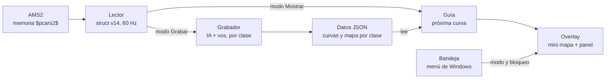

# AMS2 Asistente de Frenado – Handover

6 de noviembre de 2026 · Emiliano Daubas

> Copia en el repo del documento de diseño. La versión con comentarios vive en Claude Docs.

## Resumen y alcance

Un `.exe` para Windows que lee la telemetría de Automobilista 2 y muestra, por pista, variante y clase, dónde frena la IA y dónde frenás vos. Es un ayuda memoria para aprender o recordar circuitos, no un buscador de la frenada óptima.

Decisiones ya tomadas:

- **Entrega:** un ejecutable único, compilado por GitHub Actions en este repo.
- **Modos manuales:** Grabar (en práctica) y Mostrar (en qualy y carrera). Se cambian con el mouse, desde la ventana o el menú de la bandeja de Windows.
- **Datos:** por pista + variante + clase, no por modelo de auto.
- **Dos referencias por curva:** la mediana de la IA de tu clase y tu propia mediana.
- **Mapa propio:** se arma con las posiciones de los autos mientras se graba. No hay mapas descargables alineados con la telemetría.
- **Overlay:** una ventana siempre visible con mini mapa y panel de aproximación. Se mueve y se redimensiona; bloqueada, los clics la atraviesan.
- **Avisos:** solo visuales. El pitido es opcional y viene apagado. Sin datos, muestra "SIN DATOS". No hay aviso en vivo de "frenaste X m antes".
- **Diseño visual:** aprobado en el lienzo "AMS2 Asistente de Frenado – Overlay" (Claude Design).

Punto de partida: el prototipo en Python de la carpeta [`prototipo/`](../prototipo/). Trae un lector verificado contra `SharedMemory.h` v14 (168 campos, 20 700 bytes), un detector de frenadas, el agrupado por mediana y 12 pruebas sobre un simulador. Nunca corrió contra el juego real.

## Arquitectura

Es una app de escritorio en C# (.NET 10, WPF) que se publica como un solo `.exe`. Un temporizador lee la memoria compartida unas 60 veces por segundo, la lógica graba o calcula la guía y la ventana dibuja el resultado. El prototipo en Python queda como referencia de la lógica y del simulador.

| Módulo | Qué hace | Estado |
| --- | --- | --- |
| Lector | Abre `$pcars2$` con `MemoryMappedFile.OpenExisting` y lo copia a un `struct` con `StructLayout(Sequential)` igual al header. Descarta la lectura si `mVersion` no es 14 o `mSequenceNumber` es impar | Portar del prototipo |
| Grabador | Un detector por participante: por pedal para el auto visto y por velocidad para la IA. Agrupa por mediana | Portar; sumar clase y frenadas suaves |
| Mapa | Junta la posición (`mWorldPosition`) y la distancia de vuelta de todos los autos y arma el trazado | Nuevo |
| Guía | Con la distancia de vuelta calcula la próxima curva y el estado del panel | Portar; sumar la ventana por tiempo |
| Overlay | Ventana WPF sin bordes, siempre arriba y semitransparente. Bloqueada, deja pasar los clics (estilo Win32 `WS_EX_TRANSPARENT`) | Nuevo |
| Bandeja | Ícono con menú: modo, desbloquear, mostrar u ocultar, pitido, carpeta de datos y salir | Nuevo |
| Datos | JSON con `System.Text.Json` en `%APPDATA%\AMS2AsistenteFrenado\` | Nuevo formato por clase |
| Build | GitHub Actions en `windows-latest`: `dotnet publish -r win-x64 --self-contained -p:PublishSingleFile=true`; publica el `.exe` como Release | Nuevo |

**Campos de la memoria compartida que se usan** (todos verificados en el header v14):

- **Pista:** `mTrackLocation`, `mTrackVariation`, `mTrackLength`.
- **Clase:** `mCarClassName` para el auto visto y `mCarClassNames[64]` para cada participante.
- **Por participante:** `mParticipantInfo[i].mCurrentLapDistance`, `.mWorldPosition`, `.mLapsCompleted`, `.mIsActive`, además de `mSpeeds[64]` y `mPitModes[64]`.
- **Solo del auto visto:** `mBrake`, `mThrottle`, `mSpeed` y `mViewedParticipantIndex`.
- **Estado:** `mGameState` (jugando o replay).

**Modelo de datos.** Una carpeta por pista y variante:

- `mapa.json`: el largo de la pista y un punto cada 5 m de distancia de vuelta, con sus coordenadas `x` y `z`.
- `<clase>.json`: la lista de curvas. Cada curva lleva nombre, posición del vértice, tipo (frenada, toque o levantar) y dos bloques, `ia` y `vos`.
- Cada bloque guarda dónde frenar, el largo de la frenada, la velocidad de entrada y la del vértice, cuántas vueltas lo sostienen y la dispersión.
- Las frenadas de la IA y las tuyas se emparejan por el vértice, la velocidad mínima, que es más estable que el punto de frenado.

**Estructura de la solución (propuesta):**

- `AMS2Frenado.Core`: lector, detector, medianas, mapa y guía, sin nada de interfaz, para poder probarlo solo.
- `AMS2Frenado.App`: WPF, overlay, bandeja y configuración.
- `AMS2Frenado.Tests`: xUnit con el simulador portado del prototipo. Incluye una prueba de que el `struct` mide 20 700 bytes y de los offsets clave.

## Curvas rápidas

El aviso aparece por tiempo y no por metros fijos. Las curvas de poca frenada (como las rápidas de Silverstone) se muestran como "toque" o "levantá", con la velocidad mínima como dato principal en lugar de una cuenta de metros.

**Cuándo aparece el panel.** Cuando faltan unos 5 segundos para llegar al punto, a la velocidad actual. Tiene un mínimo de 120 m y un máximo de 400 m:

- A 216 km/h, 5 s son 300 m: el caso que ya aprobaste.
- A 150 km/h son 208 m.
- A 300 km/h serían 417 m, así que queda en 400 m.
- Se oculta pasado el vértice. Los 5 s, el mínimo y el máximo son valores a calibrar en pista.

**Tipo de curva** (se calcula al grabar; los umbrales son una propuesta a calibrar):

| Tipo | Criterio | En pantalla |
| --- | --- | --- |
| Frenada | La velocidad cae 30 km/h o más | Como en el diseño: metros hasta frenar, en grande |
| Toque | La velocidad cae entre 10 y 30 km/h | "TOQUE", con la velocidad mínima en grande y los metros en chico |
| Levantá | Cae menos de 10 km/h, o vos soltás el acelerador sin frenar | "LEVANTÁ", con la velocidad mínima en grande y sin regla de metros |

**Qué cambia en la detección:**

- El detector del prototipo exige 3 m/s² de desaceleración y 29 km/h de caída, así que hoy no ve estas curvas.
- Hace falta un segundo detector con umbrales más bajos, que busque una caída de 8 km/h o más en una ventana corta.
- En tu auto se suma el acelerador (`mThrottle`) para detectar el levantar. En la IA no hay pedales, así que se clasifica solo por la caída de velocidad.
- Las curvas a fondo no generan evento y no aparecen.

**En el mapa:** las curvas de toque o levantar se marcan con un anillo vacío en lugar de un punto lleno, para que se distingan de un vistazo.

## Agente 1 – Desarrollador senior con experiencia en mods

Construye la app en C# en este repo, por fases. Cada fase termina con algo que se puede probar, y no se avanza sin que pase su prueba.

**Recibe:** este documento, `SharedMemory.h` (v14, desde la carpeta del juego), el prototipo en Python como referencia de lógica y el lienzo de diseño.

1. **Base del repo:**
    - Solución con los tres proyectos y el workflow de GitHub Actions que compila el `.exe` y corre las pruebas.
    - El prototipo ya está en `prototipo/` como referencia.
    - Hecho cuando: un push genera el `.exe` descargable y las pruebas pasan.
2. **Lector y captura:**
    - El `struct` igual al header, la lectura con chequeo de versión y de `mSequenceNumber`, y una ventana de diagnóstico (equivalente a `dump`).
    - Una opción para guardar la telemetría cruda a un archivo, que después se reproduce en las pruebas.
    - Hecho cuando: el usuario corre el diagnóstico con AMS2 y ve bien pista, variante, clase, participantes, distancias y velocidades de la IA.
3. **Grabación:**
    - Detector fuerte (frenadas) y suave (toque y levantar), uno por participante.
    - Clave por clase y vueltas válidas: sin la primera, sin boxes y sin vueltas inválidas (`mLapsInvalidated`).
    - Mediana y dispersión, IA y vos emparejados por vértice, y el mapa con un punto cada 5 m.
    - Guardado atómico con respaldo. No pisar nombres ni notas editados a mano.
    - Hecho cuando: las pruebas con el simulador y con al menos una captura real dan curvas estables.
4. **Guía:**
    - Los estados del panel: lejos, aproximación, inminente, frená, toque, levantá y sin datos.
    - La ventana por tiempo y una histéresis para que el panel no parpadee.
5. **Overlay y bandeja:**
    - La ventana WPF según el lienzo, con bloqueo y paso de clics, y el ícono de bandeja con su menú.
    - Configuración que se recuerda: posición, tamaño, opacidad, referencia principal y pitido.
6. **Release:**
    - Un tag genera el Release con el `.exe` y notas de instalación: activar Shared Memory, Borderless y la carpeta de datos.

**Reglas para este agente:**

- Nada de inyectar código ni tocar archivos del juego: solo lectura de la memoria compartida.
- Si `mVersion` no es 14, no se lee nada más y se avisa en el panel.
- Si una lectura no tiene sentido (largo de pista en 0, nombre vacío), se espera; no se graba basura.
- Todo lo que no se pueda probar sin el juego se marca como "sin probar en AMS2" en el PR.
- `SharedMemory.h` es de los autores del juego: no se sube a este repo público. Se lee desde la carpeta de AMS2.

## Agente 2 – Diseñador UI/UX que valida

Valida que el overlay se lea de un vistazo mientras se maneja, sin tapar el juego ni distraer. Participa dos veces: antes de la fase 5 (sobre el lienzo) y después (sobre el `.exe` real).

**Recibe:** el lienzo "AMS2 Asistente de Frenado – Overlay", la sección de curvas rápidas de este documento y capturas de pantalla del juego con el overlay.

**Qué valida:**

- [ ] Se lee en menos de medio segundo: el número grande, el nombre de la curva y qué color es de quién.
- [ ] Contraste del texto de al menos 4,5:1 sobre el panel, también sobre fondos claros del juego (cielo, pianos).
- [ ] Naranja (IA) y azul (vos) se distinguen con daltonismo y también por brillo.
- [ ] Los cambios de estado no parpadean y el rojo de "FRENÁ" no resulta invasivo.
- [ ] La posición por defecto no tapa el HUD de AMS2 (tiempos, posiciones, retrovisor virtual).
- [ ] Bloquear y desbloquear se entiende sin manual, y el menú de la bandeja se encuentra.
- [ ] Los estados "SIN DATOS" y "GRABANDO" dicen qué hacer.

**Qué entrega:**

- Las pantallas nuevas en el mismo lienzo: los estados TOQUE y LEVANTÁ, y el anillo vacío en el mapa.
- Medidas finales para el desarrollador: tamaños de fuente, márgenes y colores.
- Una lista de problemas, cada uno con prioridad (bloquea, importante, menor).

## Agente 3 – Simracer que valida

Valida en pista que la app sirve para lo que se pensó: recordar dónde frenar en un circuito nuevo o que hace tiempo no se corre. No busca la frenada perfecta.

**Plan de prueba:**

1. **Tres pistas de carácter distinto:** una que conozcas bien (para juzgar si los puntos tienen sentido), una técnica y lenta, y una rápida tipo Silverstone.
2. **Dos clases:** un GT3 y un fórmula. Si se puede, una carrera multiclase para ver que cada clase se graba por separado.
3. **Grabar:**
    - Práctica con IA, unas 10 vueltas propias.
    - Revisar en el panel "GRABANDO" que suben los contadores de IA, tuyos y del mapa.
4. **Mostrar:** una qualy y una carrera corta usando solo la guía.
5. **Repetir al día siguiente** en una de las pistas, para ver si ayuda a recordar.

**Qué juzga, curva por curva:**

- ¿El punto de la IA y el tuyo son razonables, o alguno está claramente corrido?
- ¿Los 5 segundos de aviso alcanzan, o el panel aparece tarde o demasiado temprano?
- ¿Las curvas rápidas salen como TOQUE o LEVANTÁ cuando corresponde? ¿Falta alguna o sobra alguna?
- ¿El overlay distrae en carrera, con tráfico cerca?
- ¿El mapa propio se parece a la pista y ayuda a ubicarse?

**Qué entrega:** una tabla por pista y clase, con estas columnas: curva, tipo esperado, tipo mostrado, punto IA (bien, temprano o tarde), punto propio (igual) y comentario. Más una lista de los valores a calibrar: los 5 s, los umbrales de toque y levantar, y el mínimo y el máximo de aviso.

## Riesgos, supuestos y preguntas abiertas

El mayor riesgo es que nada se probó todavía contra el juego real. Por eso la fase 2 (lector y captura) es la primera compuerta.

**Verificado:**

- **Header:** el layout de `SharedMemory.h` v14 coincide campo por campo con el prototipo: 168 comprobaciones y 20 700 bytes, compilando el header real.
- **Activación:** la memoria compartida se activa en Options › System › Shared Memory = Project CARS 2, con el mismo formato que Project CARS 2 (fuentes al final).
- **Mapas:** no hay mapas descargables alineados con la telemetría. Los del juego no traen índice público y sus coordenadas no coinciden con `mWorldPosition`.
- **Datos por participante:** el header trae velocidad, distancia, posición y clase de cada uno, pero pedales solo del auto visto.

**Supuestos sin verificar (razonamiento):**

- **Datos de la IA:** las velocidades y distancias de la IA llegan con datos válidos y a la frecuencia de los cuadros.
- **Clase:** el nombre de clase es estable y agrupa bien (GT3, fórmula).
- **Mapa:** una vuelta de la IA alcanza para dibujarlo.
- **Plataforma:** .NET 10 es la versión con soporte largo vigente; confirmarlo al crear la solución.
- **Overlay:** una ventana WPF transparente sobre AMS2 en Borderless no afecta los FPS de forma perceptible.

**Riesgos:**

- Un parche de AMS2 cambia la versión de la memoria. Mitigación: el chequeo de versión y el aviso en el panel.
- La IA frena distinto con tráfico. Mitigación: la mediana de muchos autos y vueltas, y grabar en práctica.
- El antivirus marca el `.exe` sin firma. Mitigación: Release en GitHub con el código visible; firmarlo queda fuera del alcance.

**Preguntas abiertas:**

- ¿La posición por defecto del overlay va arriba a la derecha, como en la maqueta?
- ¿Los nombres de curva quedan "Curva 1…N" o se cargan los nombres oficiales en algún momento?
- ¿Arrancamos con 5 segundos de aviso?
- ¿El repo queda público?

## Referencias

- `SharedMemory.h` v14, en `Steam\steamapps\common\Automobilista 2\Support\SharedMemory\AMS2_SharedMemoryExampleApp\`.
- [Activar la telemetría en AMS2 (RaceLab)](https://docs.racelab.app/docs/first-steps/ams2)
- [Mapas en GUITRACKMAPS.bff, sin índice público (foro Reiza)](https://forum.reizastudios.com/threads/guitrackmaps-bff.36132)
- [Coordenadas .trd no alineadas con mWorldPosition (foro Reiza)](https://forum.reizastudios.com/goto/post?id=275819)
- [Misma API que Project CARS 2 (foro Reiza)](https://forum.reizastudios.com/goto/post?id=53015)
- [Shared memory se actualiza por cuadro gráfico (foro Reiza)](https://forum.reizastudios.com/posts/335619)
- Prototipo en Python: [`prototipo/`](../prototipo/).
